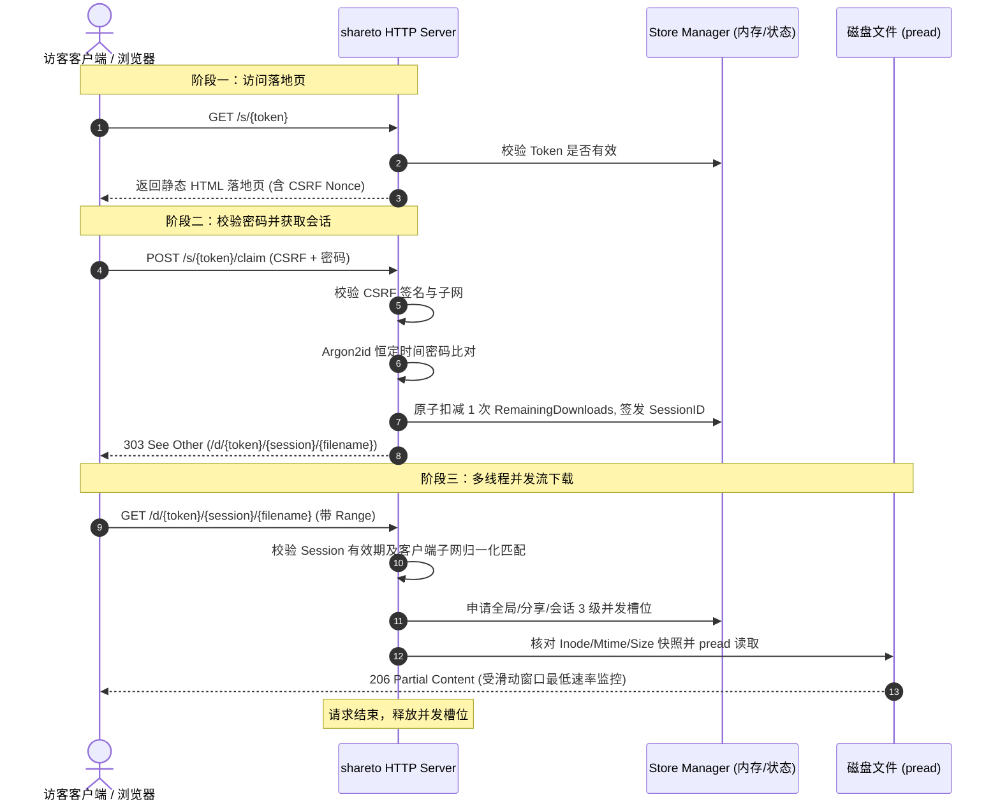

# shareto

[](https://go.dev/)
[](https://kernel.org)
[](LICENSE)

`shareto` 是专为 Linux 个人服务器与开发者打造的**极简、高安全、原子配额大文件临时分发工具**（v3.0）。

它通过内核级系统调用与契约驱动架构，提供比传统网盘、Alist 或网盘挂载工具更安全、更可控的大文件外链分发能力：支持阅后即焚（单次或多次下载额度）、子网绑定、并发限流、防爬虫误扣配额、防篡改熔断，且**全面拥抱 Go 1.22+ 原生标准库路由，零第三方重型 Web 框架**。

---

## 🌟 核心特性 (Key Features)

- 🔒 **文件句柄防篡改锁定**：
  - 采用系统调用级 `O_RDONLY | O_NOFOLLOW | O_CLOEXEC` 打开文件，禁止跨目录符号链接穿透。
  - 记录 `Dev`、`Inode`、`Mtime` 与 `FileSize` 四元组快照；若分享期间源文件被追加、截断或覆写，立即触发 `ErrFileMutated` 熔断清理并返回 `HTTP 410 Gone`。
  - 通过 `io.SectionReader`（基于系统调用 `pread`）实现 100% 协程安全的并发 HTTP Range 断点续传与多线程分片下载。
- 🛡️ **防爬虫误扣配额**：
  - 自动识别并拦截主流社交预览爬虫（微信、Telegram、Twitter/X、Slack、Discord、Facebook 等），防止聊天软件自动抓取卡片信息时偷跑一次性直链配额。
- ⚡ **两阶段会话与原子配额控制**：
  - **阶段一 (Landing/Direct)**：无消耗访问静态落地页，或通过 `?raw=1` 触发无密码直链跳转。
  - **阶段二 (Claim)**：输入密码并校验 HMAC-SHA256 CSRF 令牌，原子扣减 1 次额度，签发 2 小时绑定的 `SessionID` 并 `303` 重定向。
  - **阶段三 (Download)**：客户端绑定网段校验（IPv4 `/24`，IPv6 `/64`），杜绝会话直链跨公网非法扩散。
- 🚦 **多层级并发限制与反滥用**：
  - 三级并发槽位 CAS 控制（全局上限 64、单个分享上限 16、单个会话上限 8）。
  - 固定容量 65536 条目的并发安全 LRU 限频器，单 IP/子网 5 次密码错误锁定 15 分钟，内存严格恒定 < 10MB。
  - 防慢速读取（Slow-Read）监控：15 秒滑动窗口最低速率检测（低于 16KB/s 强制断开释放连接槽位）。
  - Argon2id 密码学哈希（带并发容量信号量防 CPU 耗尽 DoS）。
- 🔌 **内核级安全的进程间通信 (IPC)**：
  - CLI 与后台守护进程通过 Unix Domain Socket 通信（权限 `0600`）。
  - 连接时通过系统调用 `SO_PEERCRED` 校验发起端 UID，确保仅允许当前系统用户调用。
- 📦 **生产级 Systemd 用户服务**：
  - 内置内核沙箱安全指令（`ProtectSystem=strict`, `ProtectHome=read-only`, `NoNewPrivileges=true`）。
  - CLI 自动检测 Systemd 用户 linger 状态，给出操作建议。

---

## 🏗️ 交互工作流 (Workflow)



---

## 🚀 快速上手 (Quick Start)

### 1. 源码编译

环境要求：Linux，Go 1.22+。

```bash
git clone https://github.com/huadaox/shareto.git
cd shareto

# 编译单一二进制文件 (CGO_ENABLED=0)
make build
```
编译产物位于 `dist/shareto`。

### 2. 构建与安装 Debian 软件包 (.deb)

```bash
# 生成 deb 包
make deb

# 安装至系统
sudo dpkg -i dist/shareto_3.0.0_amd64.deb
```

安装后启用 Systemd 用户后台守护进程：
```bash
# 启用并立即启动守护进程
systemctl --user enable --now shareto.service

# 开启持久化运行 (保证 SSH 断开后服务不中断)
sudo loginctl enable-linger $USER
```

---

## 💻 CLI 命令与使用示例

### 1. 创建文件分享 (默认命令)

```bash
# 快速分享文件（默认有效期 24h，最大下载次数 10）
shareto /path/to/archive.iso

# 自定义有效期 (-t 支持 30m, 12h, 7d 等格式)
shareto -t 3d -m 5 /path/to/backup.tar.gz

# 启用密码保护（终端交互式无回显输入）
shareto -p /path/to/confidential.zip

# 临时指定对外访问的基础 URL（覆盖配置中的 public_base_url）
shareto --base-url https://share.example.com:38080 /path/to/file.iso

# 管道输入密码或环境变量免交互
echo "my_secret_pass" | shareto --password-stdin /path/to/data.bin
# 或
SHARETO_PASSWORD="my_password" shareto -p /path/to/data.bin
```

终端将输出公共访问链接：
```text
File successfully shared!
  Token:      m3l2Z4s8X91bC...
  Public URL: https://share.example.com/s/m3l2Z4s8X91bC...
  Direct URL: https://share.example.com/s/m3l2Z4s8X91bC...?raw=1
  Expires:    2026-10-23T23:30:00Z
  Max Claims: 5
```

> **终端直链下载模式**：若分享未设置密码，使用 `curl -L -OJ "<Public_URL>?raw=1"` 可直接重定向至流传输分片下载。

### 2. 查看当前分享列表

```bash
shareto list
```
输出示例：
```text
TOKEN       FILE             SIZE       REMAINING  STREAMS  AUTH      EXPIRES
m3l2Z4s8..  archive.iso      4.28 GB    3/10       2        None      2026-10-23T23:30:00Z
a90Kf21x..  backup.tar.gz    512.00 MB  1/5        0        Password  2026-10-24T12:00:00Z
```

### 3. 吊销指定分享

支持传入 Token 全称、前 6 位以上前缀、或原始物理文件路径：
```bash
shareto revoke m3l2Z4s8
# 或
shareto revoke /path/to/archive.iso
```

### 4. 查看守护进程状态

```bash
shareto status
```

---

## ⚙️ 配置文件说明

首次启动时，程序会在 `$XDG_CONFIG_HOME/shareto/config.json`（默认为 `~/.config/shareto/config.json`）自动生成默认配置：

```json
{
  "listen_addr": "127.0.0.1:38080",
  "public_base_url": "http://127.0.0.1:38080",
  "tls": {
    "enabled": false,
    "cert_file": "",
    "key_file": ""
  },
  "trusted_proxies": [
    "127.0.0.1/32",
    "::1/128"
  ],
  "max_global_streams": 64,
  "max_streams_per_token": 16,
  "max_streams_per_session": 8,
  "max_active_shares": 100,
  "min_transfer_rate_kbps": 16
}
```

| 字段 | 默认值 | 作用说明 |
| :--- | :--- | :--- |
| `listen_addr` | `127.0.0.1:38080` | HTTP 内部监听地址 |
| `public_base_url` | `http://127.0.0.1:38080` | 生成公共分享链接时使用的前缀（配置公网域名/反向代理时需修改） |
| `trusted_proxies` | `["127.0.0.1/32", "::1/128"]` | 可信反向代理 CIDR 列表（仅受信任代理来源允许解析 `X-Forwarded-For`） |
| `max_global_streams` | `64` | 全局允许的最大活跃下载并发连接流 |
| `max_streams_per_token` | `16` | 单个分享链接允许的最大下载并发连接流 |
| `max_streams_per_session` | `8` | 单个会话允许的最大并发连接流（多线程分片下载） |
| `min_transfer_rate_kbps`| `16` | 最低传输速率阈值（KB/s），低于该速率超 15s 强制掐断 |

> **反向代理建议**：配合 Nginx、Caddy 或 Tailscale Serve 作为前端网关，开启 HTTPS 终结并将流量反向代理至 `listen_addr` 即可。

---

## 🧪 自动化测试与工程验证

本项目包含严苛的端到端集成测试套件，全面开启 `-race` 数据竞争检测：

```bash
make test
```

测试覆盖清单：
1. **防爬虫误扣测试**：模拟多种社交平台爬虫 User-Agent 连续抓取 20 次，验证配额零误扣。
2. **并发原子扣减测试**：设置额度为 1，50 个并发 Goroutine 争抢 Claim，验证**恰好仅有 1 个请求**成功并签发 Session。
3. **多线程 Range 并发安全测试**：8 协程分片下载大文件并核验 SHA-256 哈希，验证并发 `pread` 零竞争。
4. **文件篡改熔断测试**：模拟向底层文件静默追加 1 字节，验证后续请求立即熔断返回 `410 Gone` 并清理分享。
5. **设备文件拦截**：拦截 `/dev/zero` 等特殊字符设备或空文件。
6. **IPv6 /64 子网限频测试**：模拟同 `/64` 网段不同后缀的连续爆破，验证第 6 次精准触发 `429 Too Many Requests`。

---

## 📄 License

MIT License. See [LICENSE](LICENSE) for details.
